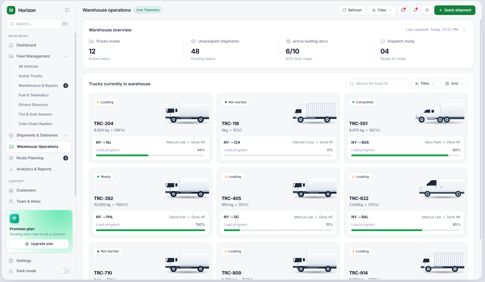

# Horizon — Warehouse & Logistics Dashboard Template



## ✨ Features

- **SPA hash routing** — every page is deep-linkable (`#/dashboard`, `#/route-planning`, …), browser back/forward works.
- **Data-driven sidebar** — the whole menu is generated from one config file (`assets/js/config.js`).
- **Modular views** — each page is a self-contained module under `assets/js/views/`.
- **Dark mode** — persisted in `localStorage`, applied before first paint.
- **Interactive demo data** — truck inspector, load progress, status filters, quick-shipment form, unassigned-shipment queue, corridor telemetry map.
- **Responsive** — sidebar collapse, grid/list toggle, mobile-friendly layouts.

## 🚀 Quick start

No install needed:

1. Clone / download this repo.
2. Open `index.html` in a browser (works from `file://`).
3. To serve locally: `python -m http.server 8000` → open `http://localhost:8000`.

> `standalone.html` is the same app bundled into a single file — handy for prototyping or sharing one attachment.

### Deploy to GitHub Pages

1. Push this repo to GitHub.
2. Repo → **Settings → Pages** → Source: `main` branch, root folder.
3. Done — your dashboard is live at `https://<user>.github.io/<repo>/`.

## 🗂 Structure

```
horizon_warehouse_logistics_dashboard/
├── index.html                 # App shell (sidebar, header, modals)
├── standalone.html            # Single-file version (optional)
├── assets/
│   ├── css/
│   │   └── theme.css          # Animations, scrollbars, progress tracks
│   └── js/
│       ├── config.js          # MENU structure, icons, page titles
│       ├── data.js            # App state + mock data (swap for your API)
│       ├── components.js      # Truck SVGs, badges, modals, toasts
│       ├── router.js          # Hash router, sidebar builder, filters, theme
│       ├── app.js             # Bootstrap
│       └── views/             # One file per page area
│           ├── warehouse.js
│           ├── dashboard.js
│           ├── shipments.js
│           ├── fleet.js
│           ├── planning.js
│           └── generic.js
├── README.md
├── LICENSE
└── .gitignore
```

## 🛠 Customize

### Add a menu item

Edit `MENU` in `assets/js/config.js`:

```js
{ key: 'fuel-telematics', label: 'Fuel & Telematics' }
```

The sidebar renders it automatically. Add the matching title to `PAGE_TITLES` in the same file.

### Add a page

1. Create `assets/js/views/my-page.js`:

```js
function renderMyPageView() {
  return `<div class="bg-white dark:bg-slate-800 rounded-2xl p-5">
    <h2>My Page</h2>
  </div>`;
}
Views['my-page'] = renderMyPageView;
```

2. Add `<script src="assets/js/views/my-page.js"></script>` to `index.html`.
3. Add `{ key: 'my-page', label: 'My Page', icon: 'analytics' }` to `MENU`.

### Swap in real data

Replace the arrays in `assets/js/data.js` with your API response. Every view reads from `state`, so the UI updates as soon as the data changes.

## 📄 License

[MIT](./LICENSE) — free to use, modify, and redistribute, including commercially.

---

### Bahasa Indonesia

Template dashboard logistik & operasi gudang gratis, open-source. Tanpa build step — cukup HTML, Tailwind CSS (CDN), dan JavaScript murni. Struktur file modular: menu sidebar dibuat otomatis dari `assets/js/config.js`, tiap halaman ada di `assets/js/views/`, dan data contoh bisa diganti dengan API milikmu di `assets/js/data.js`. Lisensi MIT — bebas dipakai siapa saja, termasuk untuk proyek komersial.
